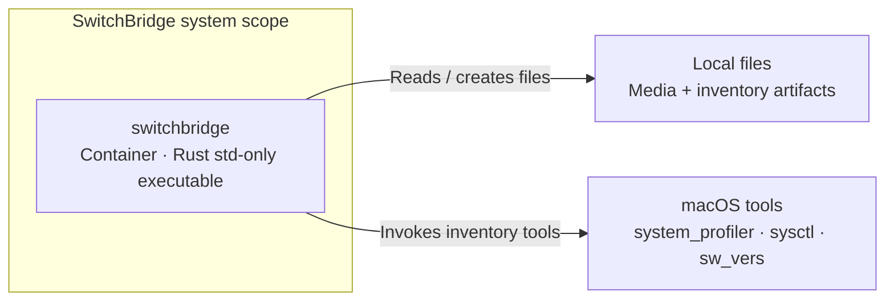

# C4 container view

**Source:** merged main `e1b81f7490ea4f5893ec8fe8b276d76ff92ed2ab`; implemented host software as of 2026-11-12. [Evidence matrix](evidence.md) · [View index](README.md).

**Audience:** Maintainers. **Purpose:** Which application implements the current system?

[Standalone HTML](diagrams/c4-container.html) · [Exact JSON](diagrams/c4-container.json) · [Portable SVG](diagrams/c4-container.portable.svg)

## Portable diagram

## Scope and legend

Cyan is the user-facing Rust CLI application container; grey is an external OS dependency or file artifact. Arrows show application dependencies, not DFD direction. The dashed boundary is system scope, not security isolation. This SwitchBridge model uses one application container because command roles are part of the same ad hoc local tool; shared binary packaging is not a universal C4 boundary rule.

Ordinary caller-selected media and inventory files sit outside the executable in this model and are data stores in the DFD. C4 can model owned storage as containers; the choice here keeps the application boundary explicit. `send`/`receive` collaboration is expanded in the prerecorded view. OS commands, ffmpeg/ffplay and CI runners remain external to the executable.

| Rust module | Responsibility | C4 interpretation |
| --- | --- | --- |
| `main` | CLI dispatch, sockets/files, exit/error reporting | Code organization within application |
| `transport` | Chunking, Annex B prefix, sequence validation | Code organization within application |
| `framing` | SWB1 header encoding/validation and payload bounds | Code organization within application |
| `usb` | OS inventory, supported redaction, snapshot/diff | Code organization within application |

No C4 component claim is made solely from these Rust module names. No separate component view is needed for the current reader questions. The executable uses Rust's standard library; no daemon, database, broker, backend or cloud runtime is implied.

## Source and review

See the [node/relationship/scenario evidence matrix](evidence.md) and [exact-byte review manifest](review/manifest.json). Legend and identifiers are shared with the accepted JSON; layout differs between portable Mermaid and standalone HTML.
