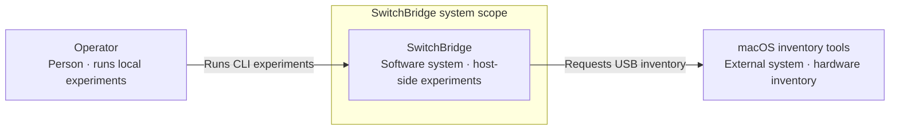

# C4 system context

**Source:** merged main `e1b81f7490ea4f5893ec8fe8b276d76ff92ed2ab`; implemented host software as of 2026-11-12. [Evidence matrix](evidence.md) · [View index](README.md).

**Audience:** New contributors and reviewers. **Purpose:** What does SwitchBridge currently do, and which external system does it use?

[Standalone HTML](diagrams/c4-context.html) · [Exact JSON](diagrams/c4-context.json) · [Portable SVG](diagrams/c4-context.portable.svg)

## Portable diagram

## Scope and legend

Arrows show static usage/dependency intent, not individual byte transfers. Cyan is the SwitchBridge software system; grey is a person or external system. The dashed boundary names product scope, not a sandbox. The isolated UNVERIFIED callout has no console video arrow.

The operator runs prerecorded transport and USB inventory experiments locally. macOS inventory facilities provide hardware inventory and host metadata. File details, transport instances and CI are deliberately expanded in their own views rather than added to this context view.

**UNVERIFIED, outside implemented flow:** there is no console USB capture source. A stock Switch 2 is not shown supplying video. Controlled USB reconnects, attributable traffic/live frames and physical projector mirroring need human evidence. The feasibility report records a present NO-GO for direct-USB product commitment, not universal impossibility.

## Source and review

See the [node/relationship/scenario evidence matrix](evidence.md) and [exact-byte review manifest](review/manifest.json). Legend and identifiers are shared with the accepted JSON; layout differs between portable Mermaid and standalone HTML.
