# Prerecorded loopback data flow

**Source:** merged main `e1b81f7490ea4f5893ec8fe8b276d76ff92ed2ab`; implemented host software as of 2026-11-12. [Evidence matrix](evidence.md) · [View index](README.md).

**Audience:** Developers and testers. **Purpose:** Which bytes move between local sender and receiver instances, and what constitutes completion?

[Standalone HTML](diagrams/dataflow-prerecorded-loopback.html) · [Exact JSON](diagrams/dataflow-prerecorded-loopback.json) · [Portable SVG](diagrams/dataflow-prerecorded-loopback.portable.svg)

## Portable diagram

```mermaid
flowchart LR
  accTitle: SwitchBridge Prerecorded loopback data flow
  accDescr: Which bytes move between local sender and receiver instances, and what constitutes completion?
  clip["INPUT.h264<br/>File store · Annex B"]
  sender["send<br/>Rust CLI · sender"]
  receiver["receive<br/>Rust CLI · receiver"]
  output["OUTPUT.h264<br/>File store · new path"]
  player["ffplay<br/>External · saved file"]
  clip -->|"1 · Annex B bytes"| sender
  sender -->|"2 · SWB1 / TCP"| receiver
  receiver -->|"3 · Payload bytes"| output
  output -->|"4 · Completed file"| player
```

## Scope and legend

Rectangles labelled as files are data stores, cyan rectangles are process instances of the same CLI, and ffplay is an external process. Numbered arrows show data direction; green highlights SWB1 over TCP. Dashed columns group flow stages, not trust zones. Sender and receiver are two invocations, not two services or C4 containers.

## Scenario and failure paths

1. `send ADDRESS INPUT.h264` reads an existing prerecorded file, checks its first four bytes for an Annex B start-code prefix and reads chunks of at most 64 KiB. Prefix checking does not validate a complete decodable H.264 bitstream.
2. A sender process connects to a numeric loopback IP with nonzero port. It writes SWB1 v1 packets: 24-byte network-order header, sequence, sender elapsed microseconds and payload. The receiver accepts payload lengths 1..1,048,576 bytes and consecutive zero-based sequence numbers. Chunk timestamps are not H.264 presentation timing.
3. `receive ADDRESS OUTPUT.h264` binds locally, creates a new output (existing paths are refused), accepts one connection, validates packets and writes only payload bytes. Clean EOF at a packet boundary ends input; empty streams fail. It flushes and exits after one stream.
4. Only after successful receiver completion does the operator compare file hashes and optionally run external `ffplay` on the completed file. ffmpeg can generate the input separately; neither tool is invoked by SwitchBridge. Playback to a physical mirrored projector remains a separate human test.

Invalid endpoints, file-open/connect/I/O failures, short/non-Annex-B inputs, malformed headers, truncated packets, invalid length/sequence and invalid first payload cause an error. On handled receiver errors it attempts to remove its partial output. Cleanup failure is logged separately and preserves the original error; process kill can leave a partial file. Connect/write/read timeouts are 10 seconds where configured; `accept()` has no timeout.

**Completion limit:** there is no ACK, end marker, expected total length or digest. Sender success is not receiver acknowledgement. Clean boundary EOF after omission of whole terminal packets can escape detection. Hash comparison is a separate operator check; it proves equality of compared files, not console capture, delivery of an expected unknown file, or physical display.

## Data and boundary context

| Element / input | Ownership and validation | Boundary meaning |
| --- | --- | --- |
| INPUT / OUTPUT | Caller-selected local files; OS file permissions apply, no special ACL policy added; output uses create-new | File-store/input-validation boundary, not automatically a trust zone |
| Sender / receiver | Rust user processes; no application sandbox or authentication implemented | Same application container, separate process instances |
| Local socket | Any local process can connect; peer loopback is checked, identity is not authenticated | Local peers are in scope as untrusted protocol inputs; loopback does not imply trusted identity |
| Packet stream | Bounded per-packet allocation, header/length/sequence/prefix validation | Protocol parser boundary; no cryptographic integrity/authentication |
| ffplay | External, operator-invoked process reads saved bytes | Post-completion tool boundary, not a live endpoint |

## Source and review

See the [node/relationship/scenario evidence matrix](evidence.md) and [exact-byte review manifest](review/manifest.json). Legend and identifiers are shared with the accepted JSON; layout differs between portable Mermaid and standalone HTML.
