# USB evidence data flow

**Source:** merged main `e1b81f7490ea4f5893ec8fe8b276d76ff92ed2ab`; implemented host software as of 2026-11-12. [Evidence matrix](evidence.md) · [View index](README.md).

**Audience:** Hardware investigators and privacy reviewers. **Purpose:** How do snapshot and diff produce local evidence without implying console video?

[Standalone HTML](diagrams/dataflow-usb-evidence.html) · [Exact JSON](diagrams/dataflow-usb-evidence.json) · [Portable SVG](diagrams/dataflow-usb-evidence.portable.svg)

## Portable diagram

```mermaid
flowchart LR
  accTitle: SwitchBridge USB evidence data flow
  accDescr: How do snapshot and diff produce local evidence without implying console video?
  os-tools["macOS tools<br/>External OS programs"]
  snapshot["usb-snapshot PATH<br/>Rust CLI · redaction"]
  snapshots["BEFORE / AFTER<br/>File stores · paths"]
  diff["usb-diff<br/>Rust CLI · diff"]
  stdout["Redacted diff<br/>stdout · review manually"]
  os-tools -->|"1 · Inventory + metadata"| snapshot
  snapshot -->|"2 · Redacted text"| snapshots
  snapshots -->|"3 · Two inventories"| diff
  diff -->|"4 · Redacted diff"| stdout
```

## Scope and legend

Grey rectangles identify external OS programs, file stores or stdout; cyan rectangles identify two separate Rust CLI command scenarios. Numbered arrows show data direction. Dashed columns organize stages, not trust zones. Redaction is a privacy transformation, not an anonymity guarantee or enforced sharing gate.

## Two command scenarios and failure paths

1. `usb-snapshot PATH` requires macOS. It invokes `/usr/sbin/system_profiler -listDataTypes`, selects `SPUSBHostDataType` with `SPUSBDataType` fallback, then collects the inventory. `/usr/sbin/sysctl -n hw.model` and `/usr/bin/sw_vers -productVersion` provide host metadata. Arrows summarize returned stdout; these OS programs are external processes, not SwitchBridge containers.
2. The same invocation redacts known supported serial/UUID/UDID private values and saves text to the caller's new path. It refuses overwrite. Malformed/empty/continued private fields fail closed for supported labels. Canonical vendor/product IDs are retained.
3. The operator runs snapshots separately before/after physical reconnects. `usb-diff BEFORE AFTER` reads two caller-selected UTF-8 files, validates both and shares known private values across both before redacting/comparing them. Inputs must be nonempty and at most 16 MiB each.
4. It prints the diff (or no-change message) to stdout. Shell redirection is the operator's choice. Manually inspect files/diff before sharing: unknown private labels, identifiers absent from recognized fields and embedded short values may remain; coincidences may also remove unrelated text.

Unsupported OS, missing profiler type, command failure, empty/non-UTF-8/oversized data, malformed supported private fields and file errors stop the command. The OS stdout limit is checked after subprocess output collection; it does not guarantee bounded subprocess-output memory. File creation is exclusive, but a write/sync failure is not documented as transactional rollback.

No automatic raw `.evidence/` store, network upload, descriptor collection, USB endpoint classification or video path exists. Three HOME disconnect/connect pairs, cable/firmware/port/state/time records and human privacy review are manual evidence work described in [the USB baseline](../usb-baseline.md). Redaction and inventories alone establish neither anonymity nor attributable console enumeration. Video remains UNVERIFIED.

## Data and boundary context

| Element / input | Ownership and controls | Boundary meaning |
| --- | --- | --- |
| macOS tools | OS-owned processes, queried read-only; stdout validated as supported inventory text | OS-process/input-validation boundary; no claimed privilege elevation |
| Snapshot / diff | Rust user processes; OS permissions apply, no application sandbox or sharing policy enforcement | Separate CLI scenarios; same chosen application container |
| BEFORE / AFTER | Caller-selected local file stores, not databases; ordinary OS file permissions | Input boundary, not automatically a new trust zone |
| Raw -> redacted text | Supported private-field transformation; no raw persistence by the tool | Privacy transformation with residual identifying data possible |
| stdout / sharing | Local output; manual review and any sharing are operator actions | Sharing is outside implemented flow; no automatic approval/upload gate |

## Source and review

See the [node/relationship/scenario evidence matrix](evidence.md) and [exact-byte review manifest](review/manifest.json). Legend and identifiers are shared with the accepted JSON; layout differs between portable Mermaid and standalone HTML.
