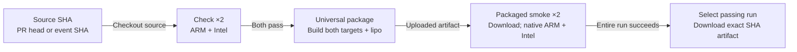

# CI artifact workflow

**Source:** merged main `e1b81f7490ea4f5893ec8fe8b276d76ff92ed2ab`; implemented host software as of 2026-11-12. [Evidence matrix](evidence.md) · [View index](README.md).

**Audience:** Contributors downloading development binaries. **Purpose:** How does pinned source become a checked universal artifact?

[Standalone HTML](diagrams/workflow-ci-artifacts.html) · [Exact JSON](diagrams/workflow-ci-artifacts.json) · [Portable SVG](diagrams/workflow-ci-artifacts.portable.svg)

## Portable diagram

## Scope and legend

Boxes are workflow activities or manual contributor actions, not product runtime containers. Arrows show dependency/artifact progression. Check and smoke each expand to parallel ARM and Intel jobs. The contributor action begins only after the entire run succeeds; artifact upload already happened before smoke.

## Implemented dependency and artifact flow

1. The `macOS` workflow runs on main push, pull request or manual dispatch. `SOURCE_SHA` is the PR head SHA or event SHA, and every checkout uses it. Workflow permissions are `contents: read`.
2. Two check jobs run on `macos-15` and `macos-15-intel`: Rust 1.96.0, formatting, locked tests and Clippy. Both must pass before package.
3. Package builds `aarch64-apple-darwin` and `x86_64-apple-darwin`, uses `lipo`, verifies both slices, archives the universal binary and internal `SHA256SUMS`, and emits an archive checksum sidecar. It uploads `switchbridge-macos-universal-<SOURCE_SHA>` with 14-day retention.
4. Two smoke jobs download that same-run artifact, verify archive/internal checksums and slices, and execute the extracted binary natively on ARM and Intel through `smoke-packaged-macos.py`. This tests prerecorded loopback transport, not hardware capture.
5. Contributor selection is manual: use an entirely passing run and its SHA-named artifact, not merely an existing upload. Verify expected hashes from trusted run evidence before executing downloaded bytes.

Failed check/package jobs stop dependent jobs; failed smoke makes the workflow unsuitable for the whole-run success criterion although the artifact may already exist. There is no Release/tag publication, signing, notarization, credential setup or product deployment stage. Checksum integrity relative to an expected trusted value is distinct from signer authenticity.

GitHub Actions infrastructure and artifact storage are outside the local application's runtime. Download crosses an external provenance boundary into a contributor's machine. Signing/authenticity and local file permissions remain separate controls; no new trust or ownership policy is invented by this diagram.

## Evidence identities

| Run / source | Scope of evidence |
| --- | --- |
| `43141901934` / `ce8aeac` | Five hosted jobs; artifact `13909373980` independently downloaded/hashed and locally tested with a 60-frame synthetic clip |
| `43164099151` / `9113cd1` | Intermediate successful PR-head status; not the older downloaded artifact |
| `43170855840` / `98afc45` | Reviewed final PR-head five-job success; no separate local artifact-byte QA claimed here |
| `43178062662` / `e1b81f7` | Merged-main push five-job success; artifact `13924514656` metadata only, no new local download/execution claim |

[Exact merged-main CI provenance](../../evidence/resume/merged-main-ci.md) records expiry and the ZIP metadata digest. [Historical downloaded-byte proof](../../evidence/resume/hosted-ci.md) stays attributed to `ce8aeac`. The frozen verification metadata's pending-hosted-CI field is historical; the later report supersedes it without rewriting that snapshot.

## Source and review

See the [node/relationship/scenario evidence matrix](evidence.md) and [exact-byte review manifest](review/manifest.json). Legend and identifiers are shared with the accepted JSON; layout differs between portable Mermaid and standalone HTML.
