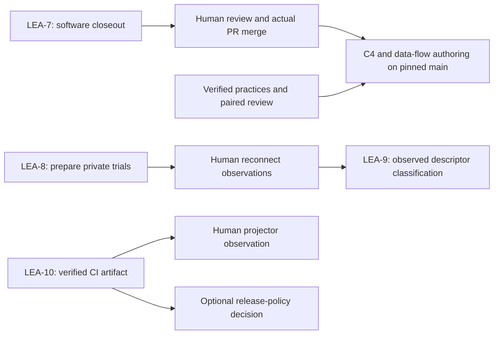

# SwitchBridge Parallel Work Plan

> **For the ticket owners:** Continue through the user-selected Herdr agents in
> isolated worktrees. This plan separates completed implementation from remaining
> closeout, hardware, documentation and release decisions. It does not authorize
> merging PRs, publishing releases, changing tickets or inventing hardware results.

**Goal:** Give each ticket a clear owner and an independent next outcome, while
keeping physical evidence, main integration and release choices explicit.

**Architecture:** Retain the existing Rust CLI, strict SWB1 framing, numeric
loopback transport, USB evidence collector and five-job Mac pipeline. Coordinate
through stable evidence handoffs rather than concurrent edits to shared files.
After an observed main merge, a documentation lead and paired researcher build
source-pinned C4 and separate data-flow views.

**Tech Stack:** Rust 1.96.0; GitHub Actions ARM/Intel macOS; existing H.264/USB
tooling; Markdown/Mermaid and planned validated Archify HTML/SVG documentation.

**Spec:** Existing [LEA-7](https://linear.app/trip123/issue/LEA-7),
[LEA-8](https://linear.app/trip123/issue/LEA-8),
[LEA-9](https://linear.app/trip123/issue/LEA-9),
[LEA-10](https://linear.app/trip123/issue/LEA-10), plus the user's requests for
one agent per ticket, a C4/data-flow research/review pair, merge monitoring,
parallel planning and a populated Agenttrail map.

## Global constraints

- Implementation is in open [PR #2](https://github.com/Kaungkhant97/switchbridge/pull/2),
  source `ce8aeac1eab18cd54c494e7b8d8445da061a7e66`. The local main checkout is
  still the scaffold; remote main contains merged LEA-9 research. Do not confuse
  either main state with the open implementation branch.
- Existing results: **46 tests**, **90.98% local source-line coverage**, passing
  [five-job hosted CI](https://github.com/Kaungkhant97/switchbridge/actions/runs/43141901934),
  verified downloadable universal artifact, and a 60-frame prerecorded H.264
  hash/decoding proof. These are not console or projector observations.
- One owner per ticket; preserve other owners' files. Shared CLI entry-point
  changes, evidence imports and integration commits go through the coordinator.
- Planning does not require rebuilding completed software. Any later behavior
  fix needs a real failing regression, minimal implementation and affected checks.
- Physical trials require the actual console/cable/projector and a human to
  operate them. Unreviewed physical captures remain in ignored `.evidence/`;
  reviewed share copies and hashes are separate deliverables.
- Release policy is unselected. Existing CI artifacts already provide delivery;
  no new tag, release, signing credential or deployment has been created.
- Parent plus six workers is the current team: four ticket owners and a two-agent
  documentation pair. No additional nested agents are needed.

## Review focus

1. A green PR is not merged main: observe merge state and pin actual main SHA.
2. Completed software is not missing hardware: keep acceptance evidence separate.
3. Raw inventory can retain identifiers: review privately before sharing copies.
4. A reused artifact must retain its exact run/SHA/hash/expiry identity.
5. A rendered diagram is not necessarily correct: require source-backed semantic
   review and actual visual inspection as separate gates.

## Owners and independent outcomes

| Lane | Herdr owner / worktree | Next outcome | Dependency |
| --- | --- | --- | --- |
| LEA-7 | `lea7-planner` (`t20`), `plan-lea7` | Closeout recommendation with source, tests, CI and artifact evidence; preserve documented transport limits | Review/merge decision and separately authorized ticket disposition; no console dependency |
| LEA-8 | `lea8-planner` (`t21`), `plan-lea8` | Three controlled HOME reconnect pairs and privacy-reviewed baseline handoff | Actual stock console, confirmed data cable and human operations |
| LEA-9 | `lea9-planner` (`t22`), `plan-lea9` | Documentary BLOCKED/NO-GO closeout; later classify only observed interfaces | Existing report can close out independently; future classification needs LEA-8 evidence and sufficient descriptors |
| LEA-10 | `switchbridge-cicd` (`t1y`), `resume-cicd` | Physical projector proof; optional release choice evaluated separately | Existing CI/artifact ready; projector/human needed; release behavior still undecided |
| Architecture | `architecture-docs-lead` (`t23`), `architecture-docs` | Source-pinned C4 context/container and separate media, USB and CI flows | Actual main merge; coordinator's consolidated-plan review |
| Research/review | Claude `architecture-research` (`t24`), `architecture-research` | Verified primary-source practices and independent semantic/visual review | Research/plan review completed; later review exact authored artifacts |

The four ticket planners completed their first drafts concurrently, then reviewed
the closeout and producer/consumer boundaries. Done/Idle means a draft is ready,
not that the ticket or physical gate has been closed. Herdr groups these workers
under the parent; the parent-group counter does not count each child separately.

## Parallel dependencies

LEA-8 preparation, LEA-7 closeout, LEA-9 documentary closeout, LEA-10 projector
preparation, and architecture research are independent. Descriptor classification
cannot precede the physical baseline. A release extension is not a prerequisite
for projector testing or documentation, and hardware feasibility is not a
prerequisite for documenting the implemented host tool honestly.

## Task 1: Consolidate and review the existing plans

**Owned by:** coordinator; lane owners retain their own files.

- [x] Read current ticket contracts, source and actual hosted evidence rather than
  repeating stale cloud/UNVERIFIED descriptions.
- [x] Assign one planning owner per ticket in dedicated worktrees and collect
  four reviewed drafts, with exact files/commands and acceptance tables.
- [x] Resolve the LEA-8/LEA-9 handoff: private raw collection under `.evidence/`,
  reviewed share copies under `evidence/`, with sanitized transformation mapping
  and verified hashes; descriptors are not inferred from inventories.
- [x] Preserve reviewed plan/research bytes and source hashes in
  `evidence/resume/parallel-planning.json`.
- [x] Finish the coordinator's consolidated review: owners, dependencies, private
  evidence handoff, source hashes and paired research corrections checked; handoff
  remains planning only, with merge, hardware and release decisions explicit.

Per-ticket plans:

- [LEA-7 transport closeout](2026-11-12-lea-7-transport-closeout.md)
- [LEA-8 physical USB baseline](2026-11-12-lea-8-usb-baseline.md)
- [LEA-9 feasibility gate](2026-11-12-lea-9-feasibility-gate.md)
- [LEA-10 builds, projector and release choices](2026-11-12-lea-10-macos-cicd.md)

## Task 2: Keep the owner's map truthful

**Owned by:** coordinator, primary checkout `PLAN.md` only. Preserve the user's
new `AGENTS.md`, `CLAUDE.md` and `.gitignore` changes.

- [x] Replace the init placeholder with nine durable responsibilities, keeping
  existing `setup` and `setup-first` IDs and stable new component/task IDs.
- [x] Add owners, actual worktree file paths, dependency edges, knowledge organs
  and an explicit human hardware card. Record decisions before changing the map.
- [x] Verify the real Agenttrail event model loads the map and all active tasks
  carry `by:`; completed tasks link to evidence.
- [ ] On a verified merge and checkout update, retarget file ownership to canonical
  main paths without changing stable IDs or overwriting user files.

## Task 3: Continue the architecture pair after the real merge

**Owned by:** documentation lead and the existing paired Claude researcher.

- [x] Research official C4 abstractions/checklist, Microsoft DFD elements and
  Mermaid notation/accessibility. Separate source claims from project modelling
  inferences; correct process-origin flows and avoid universal shared-binary rules.
- [x] Independently recheck the proposed architecture plan; no material findings
  remain in the current paired plan review.
- [~] Keep read-only merge observer `t25` / `architecture-merge-watch` running.
  It records PR state, merge timestamp and exact SHA, checks every 30 seconds with
  bounded network calls, and notifies the lead/coordinator. It never merges.
- [ ] After observed merge and the coordinator's review, pin actual main. Preserve
  draft worktrees; create a fresh documentation branch if history/untracked plans
  prevent a safe fast-forward.
- [ ] Author the five planned views and source evidence matrix, then run paired
  semantic review, renderer acceptance and actual screenshot review on exact hashes.
  Prepare a reviewable local result before any separate publication action.

See [architecture plan](2026-11-12-architecture-documentation.md) and
[verified practices](../../research/2026-11-12-c4-dataflow-practices.md).
No final C4/data-flow artifacts are claimed delivered by this planning handoff.

## Task 4: Preserve the remaining human decisions

- [ ] Review PR #2 and authorize/perform the merge separately; current CI is green.
- [ ] Confirm available console/cable/projector and select which physical trial
  to perform; the lane plans give exact commands and acceptance criteria.
- [ ] Choose draft version-tag releases, automatic public releases, or existing
  expiring CI artifacts only. Any release extension gets a concrete selected
  design before implementation; a live tag/release remains a separate operation.
- [ ] Reconcile Linear status only under explicit ticket-change authorization.
  All four tickets were still In Progress when read for this planning snapshot.

## Verification and handoff

Check plan links, unique lane ownership and the imported SHA256 manifest;
`git diff --check` must pass. Confirm all 20 frozen source/doc/helper hashes
remain unchanged before reusing runtime/CI evidence. Planning and knowledge
documents alone do not justify another local runtime test suite. A later source
change invalidates only the affected evidence and requires fresh verification.

The reviewable result is this roadmap, five lane/documentation plans, primary-source
research with paired dispositions, the living Agenttrail map and preserved hosted
CI proof. Existing per-ticket Herdr execution is the chosen method; there is no
need to select a different execution mode or rebuild completed work.
